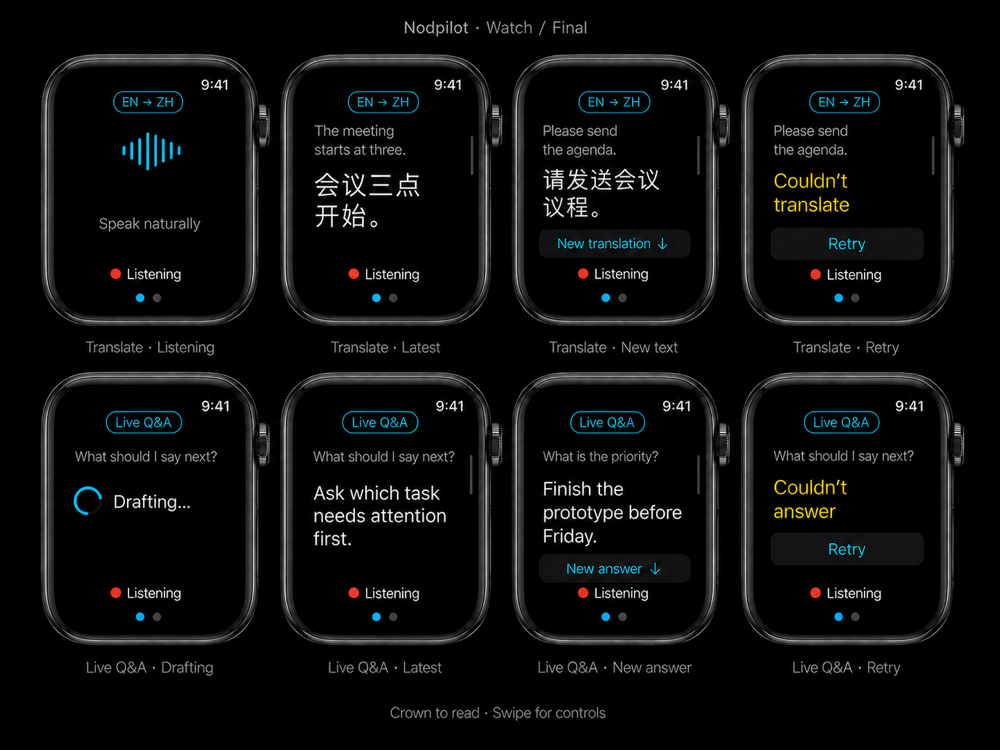

# Nodpilot · Apple Watch UI / UX 设计方案 v3
2026-09-08 · v3 整合修订 · 基于 Listen v2、Account v3 与已确认的翻译 / Live Q&A 最终图

## 方案结论
延续黑底青色、模式胶囊+Start，正常连接不显示提示；加入具有智能体感的状态动效。手机承接账号和完整管理，手表聚焦录音控制与短内容阅读。保留既有保存与同一会话语义。

## 定位
手表用于抬腕查看、快速录音控制、当前译文与回答阅读；手机承接完整设置、账号、History、PDF、完整 Transcript 与 Notes。
本交付为完整设计方案、三张高清画板与独立动态预览，不修改产品代码、不表示状态同步、保存或离线能力已实现，不替代真机验收。
保留已有的只读模式胶囊 + Start 入口，不重新引入手表模式选择器。手机决定模式、语言与场景设置。

## 画板
- assets/01-listen-flow.png：Ready、Recording、Paused、Session controls、Ended、Saved。
- assets/02-reading-and-feedback.png：保留旧画板；其中 Translate / Live Q&A 两格由最终图替代，Saving、Save failed、Connection lost、Always-On 四格继续参考。
- assets/03-translate-qa-final.png：翻译与 Live Q&A 最终图，上下两排共八个状态。
- [翻译与 Live Q&A 专项设计稿](translate-qa-design.html)：布局、阅读、新内容提示、重试及图外状态。
- 三张画板属于同一套设计；新图扩展并替代原有两个阅读示例，不按画格数量建立顶层页面。
- 概念按约 198×242 pt 手表内容区构图，实际须适配设备尺寸、安全区、大字号。原图 1536×1024，新增最终图 1448×1086；画板像素都不是运行分辨率。
- 图中的 9:41、12:34、Meeting、EN → ZH 与会话文本仅为示例。

## 01 Ready
模式胶囊、一个大 Start。正常连接时不显示 iPhone connected、手机连接图标或替代的 Ready/绿点状态行，保留留白。沿用现有模式胶囊与 Start，不增加头像、齿轮或 More。
Start 发出后显示 Starting… 并防重复触发，收到真正开始的确认后才进入 Recording，可伴随一次轻触反馈。
仅在连接异常或需要用户操作时提示。手机未登录时显示 Open Nodpilot on iPhone to sign in。移除正常连接提示不改变内部连接检查：开始操作仍需按真实连接、登录及采集状态反馈。
模式名称沿用 Meeting、Lecture、Translate、Live Q&A，不能私自切换默认场景。
麦克风授权失败显示简短原因和可行恢复入口，不清空当前会话设置。

## 02 Recording / 03 Paused
Recording：模式、录音指示、白色大号累计时间、Pause。Pause 与 End 分页，避免误触。
Paused：显示黄色 Paused，时间冻结，主按钮 Resume。Resume 继续原会话、累计录音时长继续计数。
两页以底部两个横向圆点提示，青色为当前页，左右滑动切页；不要将圆点画成更多菜单。
页面改变不停止录音；生成译文/答案也不自动切回 Ready。开始、暂停、继续失败时显示真实状态，不仅依赖乐观按钮反馈。
计时依据已确认录音状态；采集时间与生成等待时间分开，暂停期间不累计。

## 04 Session controls
录音页旁的第二页：状态、小号计时和 End recording，辅助提示 Keeps this session。
End 只停止采集，不丢弃会话、不清空 Transcript/Notes、不自动新建。
End 按钮为深红底/红色强调，与青色继续操作分开。用户发出 End 后等结束确认，期间阻止重复发送。
Translate / Live Q&A 的结束控制复用此分页结构；只提供该模式支持的操作。

## 05 Ended
显示 Ended + 累计录音时长；Save 与 Continue recording 上下排列。
Continue recording 明确继续同一会话，不触发 New session，不清空内容，时钟接着走。
Save 保留用户主动保存语义，不改成自动保存。保留手机端必要的内容/音频保存选择；若手表不能完整表达，明确引导到手机完成，不默默套用新偏好。
Save 只面向现有支持保存的 Meeting/Lecture，不能扩大到 Translate / Live Q&A。
结束页可保留待处理会话，不通过关闭或暂离页面丢弃。新建/丢弃和完整历史管理留在手机执行，并继续遵守未保存内容保护。
图中没有 New session，不代表移除手机原有入口。

## 06 Saved / 09 Saving / 10 Save failed
Save → Saving… → 对应当前会话的保存确认 → Saved to History。
Saved 页面显示 View on iPhone，此处为说明文字，不承诺自动唤起手机。继续录音按钮仍继续同一会话。
继续采集后若新增内容尚未保存，须明确标为待保存，不能让之前的 Saved 永久覆盖新增内容状态。
Saving 不显示成功勾、不允许重复提交，不抢先清空或新建；失败/超时转到 Couldn’t save，提供 Retry save。
Retry 不应重复创建历史条目。失败页面中的手机恢复入口必须真实可用；断连时重试明确反馈连接问题。
保存提示只在对应会话出现，不反复抢占屏幕；另一场会话的确认不得改变当前状态。

## 07 Translate · 最终稿
灰色原文在上，大号白色译文在下，正文左对齐。等待页仅在底部显示一处 Listening；阅读中有新内容时显示 New translation ↓，用户主动回到最新。失败保留原文与已有内容，提供 Retry / Retrying… / 成功或再次失败的完整反馈。生成与采集分别表达，操作细节见本文末「翻译与 Live Q&A 最终设计稿」。

## 08 Live Q&A · 最终稿
灰色识别问题在上，大号白色回答在下，正文左对齐。等待问题、Drafting…、成功与失败分别呈现；回读时以 New answer ↓ 提示更新，不抢阅读位置。问题来自识别，不新增手表输入框。重试仅处理对应问题，不能重复启动采集。具体规则见本文末专项设计稿。

## 11 Connection lost
画板示例为无法确认手机端采集状态的情况，显示 iPhone disconnected / Recording status unavailable / Reconnect。
不能一律称作 Recording stopped，也不能继续显示未经确认的动态计时；已确认仍在本地采集时必须采用对应的真实状态，而不是套用“未知”模板。
Reconnect 表示重新尝试应用连接/状态同步，不承诺强制开启系统蓝牙或唤醒手机；失败后说明需要在 iPhone 打开 Nodpilot。
恢复连接后读取同一会话的真实状态，不自动新建、不重复 Start。
本稿不承诺独立离线录音、缓存音频、后台常驻或断连后持续采集。

## 12 Always-On（提议调整）
常亮显示采用较暗的模式、计时和录音状态；暂停显示 Paused 与冻结时间；不播放波形动画。
建议抬腕前隐藏译文、问题和回答正文，抬腕后恢复原阅读位置。这是对已有常亮内容策略的调整提议，不能当成已上线事实。
常亮更新频率服从系统能力，不保证每秒刷新；数据过期时不能伪造实时状态。
不支持常亮的设备继续使用普通唤醒页面。

## 手机与手表边界
手机：Account、Google 登录、姓名/邮箱展示、帮助与隐私、退出/删除账号、场景和语言、History、PDF。
手表：当前模式展示、采集控制、有限内容阅读、当前会话保存与反馈。
录音来源与能力遵守既有实现，本稿不重新安排手机/手表麦克风归属。若后续需要来源提示，必须基于真实状态设计。
跨设备操作需保持同一会话身份；手机上的账号退出、删除或新建必须经过对应保护流程，不能让手表留在虚假的 Recording。

## 视觉与可访问性
背景 #050607；面板 #111518；主色 #00C4E8；主文字 #F5F7F8；辅助 #A4ABB1。红色用于采集标记/结束，黄色用于暂停和异常。
圆形/胶囊按钮采用 watchOS 原生手感；图标需配文字及可访问标签，不靠颜色单独表达状态。
正文优先于装饰，录音页以时间为视觉重点，翻译/Q&A 以正文为重点。
触控区域、字号和系统时钟安全区以实际 watchOS 设备验收，图像中的按钮尺寸不可直接当实现规格。长文和大字号允许滚动，主要按钮不可裁切。
表冠用于滚动阅读，不映射成误触结束操作；不依赖隐藏手势作为唯一入口。

## 验收
1. Ready 仅保留胶囊+Start，不展示正常连接状态；断连或需操作时才提示，不增加手表模式选择/Account/More。
2. Start、Pause、Resume、End 均有请求中/失败反馈，按真实确认更新。
3. End 后 Save 与继续同一会话均可达，原内容和累计时长保留。
4. Saving、Saved、Retry 有完整状态边界，不把“已发给手机”当保存成功。
5. 阅读新内容不抢滚动位置、不改变页面、不停止录音。
6. 断连按真实可知状态呈现，不暗示未经验证的离线能力。
7. 常亮隐私策略作为提议单独评审；适配小尺寸和大字号。
8. 设计缺少某画面不构成功能删除依据；本次未运行实现测试或改产品代码。

## 依据
用户已选 Nodpilot Listen v2、Account v3 与本任务的手表方案；参考已查看的 WatchRootView / WatchCopy / watchFace 结构和相关已确认纠错记录。仓库结构不代表用户设备正在运行的版本。
Apple 官方设计参考：
- https://developer.apple.com/design/human-interface-guidelines/designing-for-watchos/
- https://developer.apple.com/design/human-interface-guidelines/digital-crown/

## 生成与文件
使用内置 image_gen；原有画板提示词与修正记录保留在 prompts.json；本次新增 finalReadingIntegration 记录最终图来源、生成摘要与局部修正。
index.html 为总览入口，motion.html 为模拟交互与动效预览，design.html 提供易读方案。录音与通用反馈画板保留 v2 最终修订；翻译和 Live Q&A 以新增最终图为准。图片由内置 image_gen 生成，提示词保留在 prompts.json。动态预览以浏览器绘制实现，非生成视频。

## 智能体动效系统
### 核心表达
以现有波形为同一个智能体的状态表达：待命呼吸、聆听响应声音、思考形成流动光环、暂停收弱静止、成功收拢确认、异常停止流动。
不新增人物头像、机器人角色或第二个主操作；模式胶囊、Start 和原有分页继续保留。正常连接不显示 iPhone connected 或连接图标。
静态画板负责布局、按钮与层级；动态预览负责动作与状态关系。预览中的独立状态选择器、模拟声量和 Simulate failure 为演示控制，不能移植进手表产品。

### 动效位置与尺寸
| 页面 | 动效位置 | 空间规则 |
|---|---|---|
| Ready | Start 内的原波形位置 | 约 48–64 pt 视觉区域，不新增独立大卡片 |
| Recording / Paused | 录音状态旁或其上方紧凑区域 | 约 20–28 pt，高度让位于计时；不叠加第二组装饰波形 |
| 等待首个回答 | 正文尚空的内容区 | 可使用约 48–64 pt 光环；已有正文时立即缩成小指示 |
| Translate / Q&A 阅读 | 状态行的小波形 | 约 16–20 pt，不遮挡正文、不覆盖表冠阅读区域 |
| Saving | 原保存反馈图标区 | 小尺寸进度指示，不假装有精确百分比 |
| Saved | 原确认图标区 | 约 40–48 pt，确认动画一次后静止 |
| 断连 / 失败 | 原异常提示区 | 静态提示为主，录音状态未知时停用声量波形 |
| Always-On | 现有静态状态区 | 停止所有装饰动画，不绘制大光环 |

### 动效与反馈规格
以下时长是设计起点，须按真机效果与系统设置调整，不构成耗电或性能保证。
| 状态 / 事件 | 触发条件 | 动作和时长 | 停止 / 降级 | 触觉 |
|---|---|---|---|---|
| Ready | 页面可见、未采集 | 波形振幅轻微呼吸，周期约 3.8 秒 | 隐藏、息屏、减少动态效果时静态 | 无 |
| 按下按钮 | 用户触摸 | 缩小约 2%，100–150 ms 后还原 | 不延迟实际操作 | 默认不额外震动 |
| Starting | 已请求开始，尚未确认 | 原按钮显示 Starting…，小进度指示 | 成功进 Recording；失败给原因和 Retry | 确认开始后一次轻反馈 |
| Recording | 真实采集中且有可用电平 | 波形随实时声量变化；上升平滑约 80 ms，下降约 220 ms | 静音回落，不随意随机跳动；无电平时静态状态标记 | 不持续震动 |
| Thinking / Drafting | 引擎确实在生成 | 青色细光环缓慢流动，周期约 3–4 秒 | 完成后 180–250 ms 收起；失败保留内容 | 默认不震动 |
| Pause / Resume | 确认采集状态改变 | 150–220 ms 切换；暂停波形收弱、计时冻结 | 确认前不伪造已暂停 | 各一次轻反馈 |
| 新译文 / 回答 | 收到新内容 | 新段 120–180 ms 淡入，流式内容直接追加 | 减少动态效果时直接更新；已有正文不重复闪动 | 每句不震动 |
| Saving | 用户主动保存，请求未完成 | 小进度指示，持续显示等待确认 | 确认成功才切 Saved；超时或失败可 Retry | 无 |
| Saved | 匹配当前会话的成功确认 | 光线收拢并出现勾号，总计约 400–550 ms | 完成后静态，不循环庆祝 | 一次成功反馈 |
| 断连 / 失败 | 新异常确认 | 150–200 ms 显示文字和图标，停止流动 | 恢复后回到真实状态，不自动 Start | 每个异常事件一次，去重 |
| 翻页 | 用户主动切页 | 使用原生分页过渡 | 减少动态效果时弱化过渡 | 无额外连续反馈 |

### 采集、生成和保存分别表达
- Recording / Paused / Ended 表示采集状态；Thinking / Drafting 表示引擎状态；Saving / Saved 表示保存状态。三者不能共用一个互斥状态值替代真实关系。
- 录音仍在进行时允许同时显示 Thinking。光环不意味着录音结束，计时和录音标识按采集状态继续。
- 暂停后若引擎继续完成已收音频，仍可显示小的生成指示，同时明确 Paused。
- Save 的成功反馈依据对应会话和保存版本的确认，不依据动画时间或“已发送给手机”。
- 有真实麦克风电平时才能称为声量响应；无可用电平不使用随机波形假装听到声音。
- 页面切换、内容更新、进入常亮均不能引发开始、停止、清空或新建。

### 电量、可访问性与阅读
前台只运行一个主要智能体动画，不同时堆叠光环、波形、闪烁背景和粒子。优先使用原生绘制，实际帧率依设备预算决定；不照搬浏览器演示的帧循环。
开启减少动态效果后，呼吸、循环光环和形变变为静态图形；保留文字状态、计时和必要进度说明。必要操作无需等待动画完成。
退出页面、失去可见性、常亮或系统要求降低刷新时停止不必要绘制。常亮采用静态低亮度状态；刷新频率服从系统。
翻译和 Q&A 页面正文优先，动效缩小。用户向上阅读不自动抢回最新位置，流式文本不逐字弹跳或抖动。每句译文和正常重连不反复震动。
触觉在真实 Watch 上选择合适的系统反馈；浏览器预览不模拟或承诺触觉体验。

## 完整流程与异常分支
| 入口 | 处理中 | 成功 | 失败 / 取消 |
|---|---|---|---|
| Ready → Start | Starting…，阻止重复请求 | Recording，计时开始 | 保留所选模式，提示原因，允许重试 |
| Recording → Pause | 请求中，保留真实状态 | Paused，冻结累计时长 | 仍显示真实采集状态和重试 |
| Paused → Resume | 请求中 | 同一会话 Recording，累计继续 | 保留暂停与内容 |
| 控制页 → End | 结束请求中 | Ended，有内容时保留 Save / Continue | 不清内容、不伪造已结束 |
| Ended → Continue recording | 等待采集确认 | 同一会话继续、累计时长不重置 | 仍保留 Ended 与旧内容 |
| Ended → Save | Saving… | 确认后 Saved to History | Failed → Retry save，保留原内容 |
| Saved → Continue recording | 等待采集确认 | 同一会话继续；新增内容重新标记待保存 | 原已保存内容不丢失 |
| 断连 → Reconnect | 连接和状态同步中 | 恢复同一会话真实状态 | 保留异常并给手机恢复路径 |

无内容就结束时，按无内容 Ready 处理，不提供虚假的导出或保存；不得把空内容 Ended 当成新产品状态堆叠页面。
保存中若需要回到其他内容，应保留保存状态及当前会话，不重复发送。用户必须等到结果明确后再执行依赖保存成功的离开操作。
退出账号、新建、丢弃的完整保护留在手机端；手表不因为上述动效提议增加破坏性捷径。

## 状态文案
| English | 中文 |
|---|---|
| Start / Starting… | 开始 / 正在开始… |
| Recording / Pause / Paused / Resume | 录音中 / 暂停 / 已暂停 / 继续 |
| End recording / Ended | 结束录音 / 已结束 |
| Continue recording | 继续录音 |
| Thinking… / Drafting… | 思考中… / 正在生成… |
| Save / Saving… / Saved to History | 保存 / 正在保存… / 已保存到历史记录 |
| Couldn’t save / Retry save | 保存失败 / 重试保存 |
| iPhone disconnected | 与 iPhone 连接中断 |
| Recording status unavailable | 暂时无法确认录音状态 |
| Reconnect | 重新连接 |

语言跟随现有本地化策略，图中文字为示例。录音中与生成中必须使用准确文案，不能统称 Ready。

## 交付使用顺序与优先级
1. 先看静态画板确定布局和操作位置，再打开 motion.html 查看行为和动作。
2. 实现优先级：P0 真实状态、同一会话、保存确认、错误恢复；P1 波形、思考、成功动效和一次触觉；P2 真机性能与过渡微调。
3. 静态图和动态预览均为概念参考；功能语义与动效占位以本方案为准。动态预览为便于观察放大部分图形，不得在正文页照搬占满内容区的动画。
4. 本方案不创建 GitHub 执行单、不改产品代码、不进行设备部署。后续实施需按项目既有流程拆单，不能将未验证能力当成已有能力。

## 动态预览范围与验收记录
本节记录的是原 v3 模拟动效的覆盖范围。本次未扩展 motion.html 中的阅读交互；新内容提示与阅读失败重试尚不在该演示中，不能按旧演示覆盖最终阅读设计。

动态预览提供待命、开始中、聆听、结束控制、思考、暂停、结束、保存中、保存成功、保存失败、翻译、Q&A、断连、常亮；14 个可见或过渡状态；其录音与通用状态继续保留，本次新增阅读状态以最终图及专项说明为准。
可切换状态、调整模拟声量、开启减少动态效果；点击 Start / Pause / Resume / End / Save / Continue / Retry 可走模拟路径。
所有声音、录音时长、连接、保存和生成内容均为模拟，不读取麦克风、不登录、不访问业务服务，也不对真实数据执行保存、重连或删除。
保存成功在预览中使用模拟延迟；正式产品必须等待真实确认。该演示不等同 watchOS 原生交互或续航验证。

## 新增验收清单
- 待命保留胶囊+Start，无正常连接文字或图标。
- 声量响应只依据真实电平；静音、无电平有明确降级。
- 思考与采集状态独立，生成不导致停止录音或回到 Ready。
- Pause 后时间冻结；Resume / Continue 延续同一会话累计时间。
- 保存请求中、成功、失败、重试均可见；旧保存结果不覆盖新内容。
- 页面外/常亮停止装饰动效；减少动态效果不影响操作与状态识别。
- 阅读正文时动效占位缩小，新内容不抢滚动位置。
- 所有成功/错误触觉每事件一次，不按帧或重复同步消息触发。
- 小尺寸、大字号、长文案、离线与系统中断需真实设备验收；本包仅完成概念预览验证。

## 翻译与 Live Q&A 最终设计稿

[单独打开专项设计稿](translate-qa-design.html)

### 1. 定稿结论与使用范围

采用第一张备选的「原文 / 问题在上，译文 / 回答在下」布局，结合第二张的新内容提示和第三张的失败重试。正文统一左对齐；等待页只出现一处 Listening；阅读页不显示大计时器。

手表承担抬腕查看当前内容、短时回读及采集控制。手机继续承担模式、语言、场景、完整记录与管理。顶部胶囊只展示当前模式或语言方向，不增加手表模式选择器。

本稿是已确认视觉方向的设计交付，交互规则是后续实施与验收依据，不代表功能已经上线。这里的重试和新内容提示需要实现时承接真实会话与状态；不由画面推断当前设备能力，也不新增手表输入框、播放、Save 或 History。

### 2. 画板与旧包的关系

最终画板位于 assets/03-translate-qa-final.png。上排为 Translate，下排为 Live Q&A；每排从左至右四个状态。这是同一套界面的八个状态快照，不是八个独立页面或八套方案。

| 文件 / 位置 | 用途与优先级 |
| --- | --- |
| assets/01-listen-flow.png | 继续作为录音、暂停、结束、保存与继续同一会话的视觉参考 |
| assets/02-reading-and-feedback.png | 保留旧图。其 Translate / Live Q&A 两格由最终图取代；Saving、Save failed、Connection lost、Always-On 四格继续作为对应状态参考 |
| assets/03-translate-qa-final.png | 翻译与 Live Q&A 的唯一最终视觉参考 |
| translate-qa-design.md / .html | 本次阅读界面的详细设计说明，未画出的状态也在此定义 |
| design.md / .html | 整合后的完整 Watch 方案，包含本说明 |
| motion.html | 保留 v3 原有模拟动效；未补做本次新内容提示与阅读重试，不能作为这两项的交互验收结果 |

如旧图或旧动态预览与本稿的阅读布局不同，以本稿和最终图为准。采集、保存、同一会话与断连语义延续完整方案；不能因为某个操作没出现在新图里就删除旧能力。

### 3. 页面结构与文字层级

页面由五个区域组成：系统时钟安全区、只读模式 / 语言胶囊、可滚动正文区、采集状态行、横向分页圆点。正文与状态行分开；新内容提示出现时为提示按钮预留空间，不覆盖正文末行。

| 区域 | 设计规则 |
| --- | --- |
| 顶部 | EN → ZH 或 Live Q&A 青色描边胶囊；不是可点的下拉选择器 |
| 原文 / 问题 | 较小灰字、左对齐，位于其对应结果前；自然换行，不把多句拼成无对应关系的一段 |
| 译文 / 回答 | 较大白字、左对齐，是页面视觉重点；保留真实内容，不为了适配手表擅自概括或截断回答 |
| 内容容器 | 黑底直接排版，不堆叠聊天气泡、卡片或前一条正文片段；旧内容通过表冠回读 |
| 采集状态 | 真实采集中显示红点 + Listening；暂停显示 Paused，结束显示 Ended；未知时不能继续声称正在聆听 |
| 分页 | 底部两个横向圆点：阅读页第一点青色，控制页第二点青色；不画成更多菜单 |

沿用背景 #050607、面板 #111518、青色 #00C4E8、正文 #F5F7F8、辅助文字 #A4ABB1。红色只用于采集 / 结束等既有语义，黄色用于暂停与失败提示；状态同时有文字，不能只靠颜色识别。

概念内容区约 198 × 242 pt。原文和辅助文字以约 16 pt 为设计起点，主要结果约 21–24 pt；这些数值需随设备和系统字号适配。不能从画板像素直接换算实现尺寸。按钮保持可用触控区域，内容放不下时滚动，不缩小全文来强塞一屏。

### 4. Translate：四个画中状态

| 状态 | 显示内容 | 用户行为与后续 |
| --- | --- | --- |
| T1 Listening · 上排第 1 格 | 语言胶囊、波形、Speak naturally；底部红点 + Listening，整屏仅一处 Listening | 等待识别到原文；此时没有假译文。波形仅有真实电平时响应，无电平时用静态图形 |
| T2 Latest · 上排第 2 格 | 灰色原文 The meeting starts at three.；大号译文「会议三点开始。」；真实采集状态 | 抬腕阅读当前句；原文和译文作为同一个内容单元随表冠滚动 |
| T3 New text · 上排第 3 格 | 当前阅读的原文及译文保持不动；下方出现 New translation ↓ | 点提示回到最新内容；不主动点击时保留当前阅读位置 |
| T4 Retry · 上排第 4 格 | 保留失败句的原文，显示 Couldn't translate 与 Retry；底部显示真实采集状态 | 点 Retry 只重试这一句的生成；等待确认后显示译文，不启动新的采集 |

正在翻译虽未单独占一格，仍必须实现：原文保留，译文位置显示小进度指示与 Translating…；已有部分译文时保留正文，小指示让位于内容。不能把 Translating… 当成采集停止，也不能自动返回 Ready。

同语言直通时不重复显示两份相同文本。原文修订与译文必须仍对应同一条内容，不把上一句译文挂到下一句原文下。

### 5. Live Q&A：四个画中状态

| 状态 | 显示内容 | 用户行为与后续 |
| --- | --- | --- |
| Q1 Drafting · 下排第 1 格 | 上方保留已识别的问题，小进度指示 + Drafting… 占据回答区 | 等待生成；若仍在真实采集，底部可同时显示 Listening；生成完成不强制改变分页 |
| Q2 Latest · 下排第 2 格 | 灰色问题 What should I say next?；白色回答 Ask which task needs attention first. | 先确认问题，再读答案；表冠查看长回答 |
| Q3 New answer · 下排第 3 格 | 当前问题与回答保持原位；出现 New answer ↓ | 用户主动回到最新；不把新答案覆盖到正在阅读的旧问题下面 |
| Q4 Retry · 下排第 4 格 | 问题保留，显示 Couldn't answer 与 Retry | 只重试对应问题；不重复开麦、不新建会话、不把旧问题的响应填到新问题下 |

首次等待问题未另画一格：显示小波形与辅助文字 Waiting for a question，底部按真实采集显示一处 Listening。问题来自当前识别内容，不增加手表键盘、输入框或独立提问按钮。

图中 Drafting 与 Listening 同时出现只代表「生成时仍在采集」这一组合；若真实采集已暂停或结束，底部必须对应显示 Paused 或 Ended。不能为了复刻图稿，强制改变原有采集行为。

### 6. 滚动、长文与新内容提示

表冠或纵向触摸滚动负责阅读，横向滑动进入控制页。回到阅读页时恢复该会话的阅读位置。分页圆点是页面位置提示；可访问性操作应提供阅读页与控制页的可达入口，不能仅依赖用户猜手势。

默认先展示最新原文 / 问题的开头及其结果开头。在当前内容流式生成时保持已有可见行的位置，不逐字滚到尾部；长回答超出一屏后由用户滚动，不能为了追踪输出把开头挤走。

用户停留在最新内容并且没有主动回读时，可以在新的一句 / 新的问题到达后展示最新内容。用户一旦向上阅读旧内容，或正在阅读当前长回答中段，就锁定阅读锚点；此后新段到达只显示对应提示，不抢位置。

New translation / New answer 只在当前阅读位置之外确有未看的更新时出现。同一屏只显示一个提示按钮，多次更新合并提示，不堆叠按钮，不伪造计数。提示是阅读更新，不表示新录音会话。

点击提示后跳到最新内容单元的开头，让用户先看到来源，再看到结果；这不是盲目跳到答案最后一行。用户通过表冠自己读到最新位置时也可清除提示。仅清除已呈现的更新，仍在途的新内容可继续触发提示。

首次展示以当前单元为主，不把旧句压在顶部占空间。回读范围服从真实可用数据；更早的完整记录由手机承接，不承诺手表缓存整个历史。原文过长时仍和结果保留对应关系，通过滚动阅读，不能用未定义的摘要替代。

### 7. 重试与局部失败

| 阶段 | 反馈与内容保留 |
| --- | --- |
| 生成失败 | 保留对应原文 / 问题和已收到的部分结果；结果不完整时明确显示失败，不伪装成完整答案 |
| 进入 Retry | 按钮变为 Retrying… 并暂时防重复点击；保留内容和当前页面 |
| 重试成功 | 更新对应内容单元的结果并解除错误反馈；若用户正在看别处，不强制跳回 |
| 重试再次失败 / 超时 | 恢复可点 Retry，保留失败原因与内容，不无限卡在处理中 |
| 断连 | 说明需恢复与 iPhone 的连接；不把 Retry 当成连接成功，也不假装已经发送 |
| 不可重试条件 | 登录、权限或额度问题显示简短原因和真实可行的手机恢复提示，不让无效 Retry 无限制循环 |

失败图画的是当前条目没有成功结果的简单情形，不代表删除上一条成功内容；其他条目仍可在已有阅读范围内回看。重试结果需对应同一会话、同一原文 / 问题及有效请求；过期结果不能覆盖更新的内容。这里约束用户可见行为，不指定未经核对的代码字段或重试次数。

### 8. 采集状态、控制页与跨设备关系

| 采集状态 | 生成状态示例 | 阅读页应如何表现 |
| --- | --- | --- |
| Listening | 空闲 / Translating / Drafting / 失败 | 保留对应内容或处理反馈，底部红点 + Listening |
| Paused | 仍在生成 | 保留内容与小进度指示，底部 Paused；生成不等于恢复采集 |
| Ended | 正在完成最后结果 | 内容留在当前会话，底部 Ended；收到结果不会自动新建或返回 Ready |
| 无法确认 | 任意旧状态 | 不沿用未经确认的 Listening；按原包 Connection lost 规则说明状态未知并提供恢复方式 |

横滑到控制页不结束录音，也不清空阅读位置。Pause / Resume / End 只出现该模式真实支持的操作，继续沿用原包的控制与确认反馈。End 只停止采集；不能因为结束或重试而清空当前内容。保存范围仍只按原方案支持的 Meeting / Lecture 处理，不扩大到 Translate / Live Q&A。

模式与语言由手机决定；切换后的状态以同一会话的真实同步为依据。手机已有播放、自动朗读、音色、语言设置等能力不因手表图中未出现而被移除。断连与重连不承诺独立离线录音或强制唤醒手机。

### 9. 动效与可访问性

阅读时动画缩小，正文优先。生成指示建议约 16–20 pt；已出文字时不再占用大面积光环。波形只有真实采集电平时才随声音变化；正常新句或新回答不反复震动。

新文字使用短暂淡入或直接追加，不逐字弹跳，不反复闪烁已读正文。减少动态效果时用静态标记与文字；状态反馈不能依赖动画才能理解。常亮模式沿用原包的低亮度与隐私提议，抬腕恢复阅读位置。

支持系统字号与 VoiceOver。原文、译文、问题、回答、新内容提示和 Retry 都提供明确语义；不要让流式内容每个字都打断朗读。小尺寸、长英文、中文换行与大字号需要在真实 Watch 上验收。

### 10. 图外状态文案

| English | 中文 | 使用条件 |
| --- | --- | --- |
| Speak naturally | 自然说话即可 | 翻译等待识别的辅助提示 |
| Waiting for a question | 等待问题 | Q&A 尚未识别到问题，避免重复 Listening |
| Listening | 聆听中 | 仅真实采集中 |
| Translating… / Drafting… | 正在翻译… / 正在生成… | 对应引擎确实正在生成 |
| New translation ↓ / New answer ↓ | 新译文 ↓ / 新回答 ↓ | 有当前阅读位置之外的更新 |
| Couldn't translate / Couldn't answer | 翻译失败 / 回答失败 | 对应条目生成失败 |
| Retry / Retrying… | 重试 / 正在重试… | 可重试 / 已提交且仍在处理 |
| Paused / Ended | 已暂停 / 已结束 | 真实采集状态 |

画板英文是示例界面语言；界面文案跟随产品本地化策略，译文语言跟随手机所选方向。不得因为文案翻译而改变采集状态含义。

### 11. 设计验收清单

- 阅读正文统一左对齐；原文 / 问题在对应结果上方，主要结果最醒目。
- 等待页 Listening 不重复；阅读页不被大计时器、装饰或旧内容片段挤占。
- 翻译等待识别、正在翻译、成功、失败可区分；Q&A 等待问题、生成、成功、失败可区分。
- 用户回读或阅读长回答时，新内容不抢位置；提示可点且不会遮住正文。
- 回到最新显示来源与结果开头；不能跳到只剩最后一行的尾部。
- Retry、Retrying、成功、再次失败、超时均有明确出口；内容不丢、不重复开麦。
- 采集与生成分别表达；Paused / Ended 时仍能显示待完成的结果，不伪造 Listening。
- 翻页、息屏、重连和结果更新不清空会话；过期响应不覆盖新问题。
- 无内容或无数据时不伪造原文、译文、答案或成功反馈。
- 大字号、长文、VoiceOver、减少动态效果和常亮策略均可验证；不靠缩小文字或隐藏关键操作适配。

### 12. 交付记录

本次完成最终图入包、阅读设计稿、总览与完整方案更新，以及压缩包和本地链接完整性检查。原有动效示例保留并注明覆盖范围。本次未改产品代码、未创建执行单、未进行设备部署或真机可用性验收。
