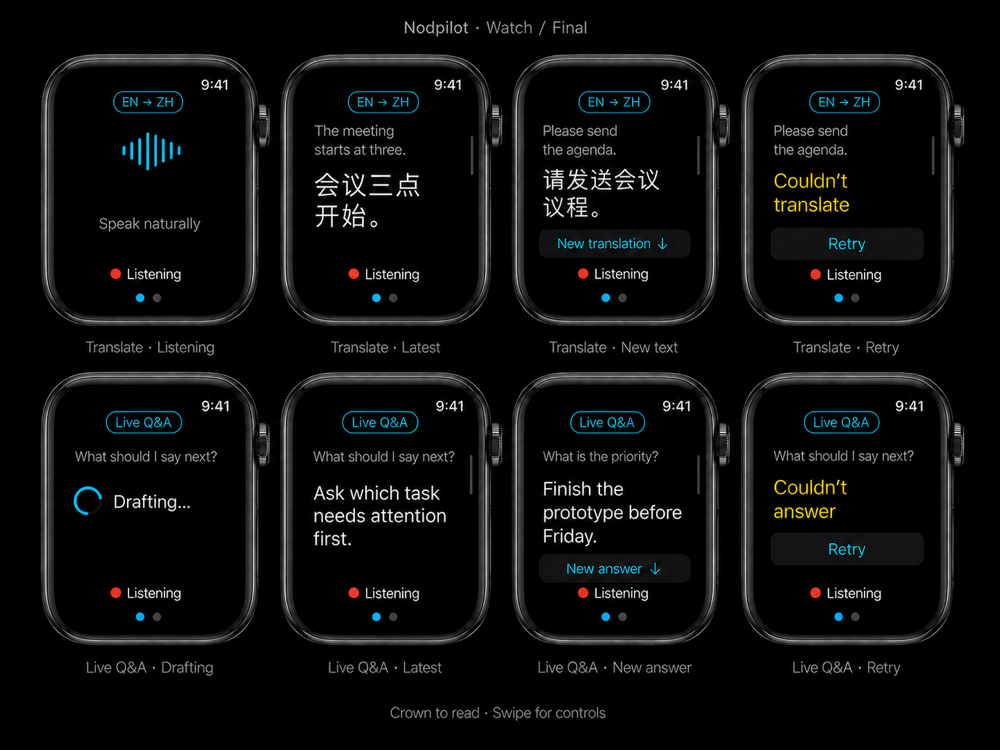

# Translate & Live Q&A · 手表最终设计稿

2026-09-08 · Watch v3 整合修订 · 以用户确认的最终图为视觉依据

[返回总览](index.html) · [完整 Watch 方案](design.html) · [查看最终图](assets/03-translate-qa-final.png)

## 1. 定稿结论与使用范围

采用第一张备选的「原文 / 问题在上，译文 / 回答在下」布局，结合第二张的新内容提示和第三张的失败重试。正文统一左对齐；等待页只出现一处 Listening；阅读页不显示大计时器。

手表承担抬腕查看当前内容、短时回读及采集控制。手机继续承担模式、语言、场景、完整记录与管理。顶部胶囊只展示当前模式或语言方向，不增加手表模式选择器。

本稿是已确认视觉方向的设计交付，交互规则是后续实施与验收依据，不代表功能已经上线。这里的重试和新内容提示需要实现时承接真实会话与状态；不由画面推断当前设备能力，也不新增手表输入框、播放、Save 或 History。

## 2. 画板与旧包的关系

最终画板位于 assets/03-translate-qa-final.png。上排为 Translate，下排为 Live Q&A；每排从左至右四个状态。这是同一套界面的八个状态快照，不是八个独立页面或八套方案。

| 文件 / 位置 | 用途与优先级 |
| --- | --- |
| assets/01-listen-flow.png | 继续作为录音、暂停、结束、保存与继续同一会话的视觉参考 |
| assets/02-reading-and-feedback.png | 保留旧图。其 Translate / Live Q&A 两格由最终图取代；Saving、Save failed、Connection lost、Always-On 四格继续作为对应状态参考 |
| assets/03-translate-qa-final.png | 翻译与 Live Q&A 的唯一最终视觉参考 |
| translate-qa-design.md / .html | 本次阅读界面的详细设计说明，未画出的状态也在此定义 |
| design.md / .html | 整合后的完整 Watch 方案，包含本说明 |
| motion.html | 保留 v3 原有模拟动效；未补做本次新内容提示与阅读重试，不能作为这两项的交互验收结果 |

如旧图或旧动态预览与本稿的阅读布局不同，以本稿和最终图为准。采集、保存、同一会话与断连语义延续完整方案；不能因为某个操作没出现在新图里就删除旧能力。

## 3. 页面结构与文字层级

页面由五个区域组成：系统时钟安全区、只读模式 / 语言胶囊、可滚动正文区、采集状态行、横向分页圆点。正文与状态行分开；新内容提示出现时为提示按钮预留空间，不覆盖正文末行。

| 区域 | 设计规则 |
| --- | --- |
| 顶部 | EN → ZH 或 Live Q&A 青色描边胶囊；不是可点的下拉选择器 |
| 原文 / 问题 | 较小灰字、左对齐，位于其对应结果前；自然换行，不把多句拼成无对应关系的一段 |
| 译文 / 回答 | 较大白字、左对齐，是页面视觉重点；保留真实内容，不为了适配手表擅自概括或截断回答 |
| 内容容器 | 黑底直接排版，不堆叠聊天气泡、卡片或前一条正文片段；旧内容通过表冠回读 |
| 采集状态 | 真实采集中显示红点 + Listening；暂停显示 Paused，结束显示 Ended；未知时不能继续声称正在聆听 |
| 分页 | 底部两个横向圆点：阅读页第一点青色，控制页第二点青色；不画成更多菜单 |

沿用背景 #050607、面板 #111518、青色 #00C4E8、正文 #F5F7F8、辅助文字 #A4ABB1。红色只用于采集 / 结束等既有语义，黄色用于暂停与失败提示；状态同时有文字，不能只靠颜色识别。

概念内容区约 198 × 242 pt。原文和辅助文字以约 16 pt 为设计起点，主要结果约 21–24 pt；这些数值需随设备和系统字号适配。不能从画板像素直接换算实现尺寸。按钮保持可用触控区域，内容放不下时滚动，不缩小全文来强塞一屏。

## 4. Translate：四个画中状态

| 状态 | 显示内容 | 用户行为与后续 |
| --- | --- | --- |
| T1 Listening · 上排第 1 格 | 语言胶囊、波形、Speak naturally；底部红点 + Listening，整屏仅一处 Listening | 等待识别到原文；此时没有假译文。波形仅有真实电平时响应，无电平时用静态图形 |
| T2 Latest · 上排第 2 格 | 灰色原文 The meeting starts at three.；大号译文「会议三点开始。」；真实采集状态 | 抬腕阅读当前句；原文和译文作为同一个内容单元随表冠滚动 |
| T3 New text · 上排第 3 格 | 当前阅读的原文及译文保持不动；下方出现 New translation ↓ | 点提示回到最新内容；不主动点击时保留当前阅读位置 |
| T4 Retry · 上排第 4 格 | 保留失败句的原文，显示 Couldn't translate 与 Retry；底部显示真实采集状态 | 点 Retry 只重试这一句的生成；等待确认后显示译文，不启动新的采集 |

正在翻译虽未单独占一格，仍必须实现：原文保留，译文位置显示小进度指示与 Translating…；已有部分译文时保留正文，小指示让位于内容。不能把 Translating… 当成采集停止，也不能自动返回 Ready。

同语言直通时不重复显示两份相同文本。原文修订与译文必须仍对应同一条内容，不把上一句译文挂到下一句原文下。

## 5. Live Q&A：四个画中状态

| 状态 | 显示内容 | 用户行为与后续 |
| --- | --- | --- |
| Q1 Drafting · 下排第 1 格 | 上方保留已识别的问题，小进度指示 + Drafting… 占据回答区 | 等待生成；若仍在真实采集，底部可同时显示 Listening；生成完成不强制改变分页 |
| Q2 Latest · 下排第 2 格 | 灰色问题 What should I say next?；白色回答 Ask which task needs attention first. | 先确认问题，再读答案；表冠查看长回答 |
| Q3 New answer · 下排第 3 格 | 当前问题与回答保持原位；出现 New answer ↓ | 用户主动回到最新；不把新答案覆盖到正在阅读的旧问题下面 |
| Q4 Retry · 下排第 4 格 | 问题保留，显示 Couldn't answer 与 Retry | 只重试对应问题；不重复开麦、不新建会话、不把旧问题的响应填到新问题下 |

首次等待问题未另画一格：显示小波形与辅助文字 Waiting for a question，底部按真实采集显示一处 Listening。问题来自当前识别内容，不增加手表键盘、输入框或独立提问按钮。

图中 Drafting 与 Listening 同时出现只代表「生成时仍在采集」这一组合；若真实采集已暂停或结束，底部必须对应显示 Paused 或 Ended。不能为了复刻图稿，强制改变原有采集行为。

## 6. 滚动、长文与新内容提示

表冠或纵向触摸滚动负责阅读，横向滑动进入控制页。回到阅读页时恢复该会话的阅读位置。分页圆点是页面位置提示；可访问性操作应提供阅读页与控制页的可达入口，不能仅依赖用户猜手势。

默认先展示最新原文 / 问题的开头及其结果开头。在当前内容流式生成时保持已有可见行的位置，不逐字滚到尾部；长回答超出一屏后由用户滚动，不能为了追踪输出把开头挤走。

用户停留在最新内容并且没有主动回读时，可以在新的一句 / 新的问题到达后展示最新内容。用户一旦向上阅读旧内容，或正在阅读当前长回答中段，就锁定阅读锚点；此后新段到达只显示对应提示，不抢位置。

New translation / New answer 只在当前阅读位置之外确有未看的更新时出现。同一屏只显示一个提示按钮，多次更新合并提示，不堆叠按钮，不伪造计数。提示是阅读更新，不表示新录音会话。

点击提示后跳到最新内容单元的开头，让用户先看到来源，再看到结果；这不是盲目跳到答案最后一行。用户通过表冠自己读到最新位置时也可清除提示。仅清除已呈现的更新，仍在途的新内容可继续触发提示。

首次展示以当前单元为主，不把旧句压在顶部占空间。回读范围服从真实可用数据；更早的完整记录由手机承接，不承诺手表缓存整个历史。原文过长时仍和结果保留对应关系，通过滚动阅读，不能用未定义的摘要替代。

## 7. 重试与局部失败

| 阶段 | 反馈与内容保留 |
| --- | --- |
| 生成失败 | 保留对应原文 / 问题和已收到的部分结果；结果不完整时明确显示失败，不伪装成完整答案 |
| 进入 Retry | 按钮变为 Retrying… 并暂时防重复点击；保留内容和当前页面 |
| 重试成功 | 更新对应内容单元的结果并解除错误反馈；若用户正在看别处，不强制跳回 |
| 重试再次失败 / 超时 | 恢复可点 Retry，保留失败原因与内容，不无限卡在处理中 |
| 断连 | 说明需恢复与 iPhone 的连接；不把 Retry 当成连接成功，也不假装已经发送 |
| 不可重试条件 | 登录、权限或额度问题显示简短原因和真实可行的手机恢复提示，不让无效 Retry 无限制循环 |

失败图画的是当前条目没有成功结果的简单情形，不代表删除上一条成功内容；其他条目仍可在已有阅读范围内回看。重试结果需对应同一会话、同一原文 / 问题及有效请求；过期结果不能覆盖更新的内容。这里约束用户可见行为，不指定未经核对的代码字段或重试次数。

## 8. 采集状态、控制页与跨设备关系

| 采集状态 | 生成状态示例 | 阅读页应如何表现 |
| --- | --- | --- |
| Listening | 空闲 / Translating / Drafting / 失败 | 保留对应内容或处理反馈，底部红点 + Listening |
| Paused | 仍在生成 | 保留内容与小进度指示，底部 Paused；生成不等于恢复采集 |
| Ended | 正在完成最后结果 | 内容留在当前会话，底部 Ended；收到结果不会自动新建或返回 Ready |
| 无法确认 | 任意旧状态 | 不沿用未经确认的 Listening；按原包 Connection lost 规则说明状态未知并提供恢复方式 |

横滑到控制页不结束录音，也不清空阅读位置。Pause / Resume / End 只出现该模式真实支持的操作，继续沿用原包的控制与确认反馈。End 只停止采集；不能因为结束或重试而清空当前内容。保存范围仍只按原方案支持的 Meeting / Lecture 处理，不扩大到 Translate / Live Q&A。

模式与语言由手机决定；切换后的状态以同一会话的真实同步为依据。手机已有播放、自动朗读、音色、语言设置等能力不因手表图中未出现而被移除。断连与重连不承诺独立离线录音或强制唤醒手机。

## 9. 动效与可访问性

阅读时动画缩小，正文优先。生成指示建议约 16–20 pt；已出文字时不再占用大面积光环。波形只有真实采集电平时才随声音变化；正常新句或新回答不反复震动。

新文字使用短暂淡入或直接追加，不逐字弹跳，不反复闪烁已读正文。减少动态效果时用静态标记与文字；状态反馈不能依赖动画才能理解。常亮模式沿用原包的低亮度与隐私提议，抬腕恢复阅读位置。

支持系统字号与 VoiceOver。原文、译文、问题、回答、新内容提示和 Retry 都提供明确语义；不要让流式内容每个字都打断朗读。小尺寸、长英文、中文换行与大字号需要在真实 Watch 上验收。

## 10. 图外状态文案

| English | 中文 | 使用条件 |
| --- | --- | --- |
| Speak naturally | 自然说话即可 | 翻译等待识别的辅助提示 |
| Waiting for a question | 等待问题 | Q&A 尚未识别到问题，避免重复 Listening |
| Listening | 聆听中 | 仅真实采集中 |
| Translating… / Drafting… | 正在翻译… / 正在生成… | 对应引擎确实正在生成 |
| New translation ↓ / New answer ↓ | 新译文 ↓ / 新回答 ↓ | 有当前阅读位置之外的更新 |
| Couldn't translate / Couldn't answer | 翻译失败 / 回答失败 | 对应条目生成失败 |
| Retry / Retrying… | 重试 / 正在重试… | 可重试 / 已提交且仍在处理 |
| Paused / Ended | 已暂停 / 已结束 | 真实采集状态 |

画板英文是示例界面语言；界面文案跟随产品本地化策略，译文语言跟随手机所选方向。不得因为文案翻译而改变采集状态含义。

## 11. 设计验收清单

- 阅读正文统一左对齐；原文 / 问题在对应结果上方，主要结果最醒目。
- 等待页 Listening 不重复；阅读页不被大计时器、装饰或旧内容片段挤占。
- 翻译等待识别、正在翻译、成功、失败可区分；Q&A 等待问题、生成、成功、失败可区分。
- 用户回读或阅读长回答时，新内容不抢位置；提示可点且不会遮住正文。
- 回到最新显示来源与结果开头；不能跳到只剩最后一行的尾部。
- Retry、Retrying、成功、再次失败、超时均有明确出口；内容不丢、不重复开麦。
- 采集与生成分别表达；Paused / Ended 时仍能显示待完成的结果，不伪造 Listening。
- 翻页、息屏、重连和结果更新不清空会话；过期响应不覆盖新问题。
- 无内容或无数据时不伪造原文、译文、答案或成功反馈。
- 大字号、长文、VoiceOver、减少动态效果和常亮策略均可验证；不靠缩小文字或隐藏关键操作适配。

## 12. 交付记录

本次完成最终图入包、阅读设计稿、总览与完整方案更新，以及压缩包和本地链接完整性检查。原有动效示例保留并注明覆盖范围。本次未改产品代码、未创建执行单、未进行设备部署或真机可用性验收。
